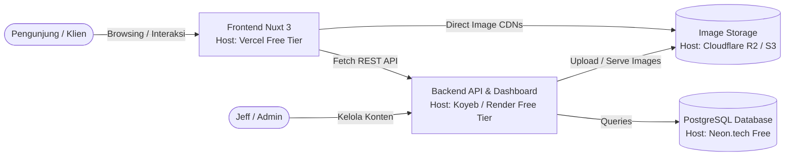

# Product Requirements Document (PRD)
## Jeff Lee — Photography Portfolio & Booking Platform

* **Document Version:** 1.0.0
* **Last Updated:** 2026-10-25
* **Author:** Antigravity Pair Programming & yodi-dev
* **Status:** In Progress (Phase 1 Completed, Phase 2 In Progress)

---

## 1. Project Overview & Vision

### 1.1 Objective
Membangun website portofolio profesional untuk fotografer **Jeff Lee** yang beroperasi di Australia. Website ini dirancang untuk menampilkan karya fotografi bertema, menceritakan kisah/refleksi di balik setiap pemotretan, dan memfasilitasi calon klien untuk melakukan reservasi (*booking*) pemotretan secara langsung.

### 1.2 Architectural Strategy: Decoupled / Headless System
Untuk menjamin performa maksimal, skalabilitas, dan kemudahan pengelolaan, proyek ini dibangun dengan arsitektur terpisah (*decoupled*):

* **Frontend (Client-Facing Web):** [portfolio-jeff](https://github.com/yodi-dev/portfolio-jeff)
  * Framework: **Nuxt 3 (v3.17)** + **Vue 3 (v3.5)** + **Tailwind CSS 3.4** + **TypeScript**.
  * Peran: Antarmuka publik yang cepat, responsif, SEO-friendly (SSR/SSG), dengan *dark mode support*.
* **Backend (Headless API & CMS):** [dashboard-jef](https://github.com/yodi-dev/dashboard-jef)
  * Framework: **Laravel 12** + **Laravel Breeze** + **Sanctum** + **MySQL / PostgreSQL**.
  * Peran: Dashboard admin untuk mengelola portofolio, artikel, reservasi booking, dan otomatisasi pengiriman email notifikasi.

---

## 2. Functional Requirements (Berdasarkan Brief Klien)

### 2.1 Main Page (Homepage — `/`)
* **Hero Banner / Cover Photo:** Tampilan *fullscreen* beresolusi tinggi dengan overlay gelap untuk keterbacaan teks.
* **Branding:** Nama fotografer ("Jeff Lee") dan *brand mark* yang konsisten.
* **Headline & Tagline:** Pengantar filosofi fotografi (*natural light, storytelling, authentic moments*).
* **Teaser Sections:** Cuplikan *Selected Works*, *Thoughts & Stories*, cuplikan profil *About Jeff*, *Testimonials*, dan *Call to Action* menuju halaman booking.

### 2.2 About Page (`/about`)
* **Photographer Story & Journey:** Narasi mendalam mengenai awal mula ketertarikan Jeff pada dunia fotografi, pengalaman di Australia, dan pendekatannya dalam memotret momen keluarga dan manusia.
* **Visuals:** Foto profil portrait resmi dan cuplikan foto *behind-the-scenes* (BTS).
* **Quick Contact:** Tautan email langsung (`mailto:`) dan tautan media sosial aktif.

### 2.3 Works / Portfolio Page (`/works`)
* **Galeri Terorganisir Berdasarkan 11 Tema:**
  1. *Family*
  2. *Portrait*
  3. *Couple*
  4. *Newborn*
  5. *Work Documentary*
  6. *Animal*
  7. *Plant*
  8. *Sports*
  9. *Event*
  10. *Celebration*
  11. *Travel*
* **Interactive Filtering:** Navigasi kategori interaktif (pilihan "All" + 11 kategori) tanpa perlu reload halaman.
* **Lightbox / Image Preview:** Kemampuan memperbesar tampilan foto saat diklik beserta informasi judul dan kategorinya.
* **API Integration:** Data foto diambil secara dinamis dari `GET /api/portfolios`.

### 2.4 Writing / Stories Page (`/writing` & `/writing/[slug]`)
* **Blog / Stories Section:** Wadah personal bagi Jeff untuk berbagi cerita refleksi dan kisah emosional di balik foto.
* **List Page (`/writing`):** Menampilkan artikel terpublikasi dengan kartu artikel (cover foto, tanggal rilis, judul, ringkasan/excerpt).
* **Detail Page (`/writing/[slug]`):** Halaman artikel lengkap dinamis berdasarkan slug, dengan tipografi rapi dan tautan kembali.
* **API Integration:** Data artikel diambil dari `GET /api/articles` dan `GET /api/articles/{slug}`.

### 2.5 Booking Page (`/booking`)
* **Booking Form:** Formulir pemesanan sesi foto terpadu yang memvalidasi data calon klien:
  * **Name:** Nama lengkap klien (`required`).
  * **Email:** Alamat email aktif (`required|email`).
  * **Phone / WhatsApp:** Nomor telepon/kontak aktif (`required`).
  * **Package / Shoot Type:** Dropdown pilihan jenis pemotretan selaras dengan 11 tema portofolio (`required`).
  * **Booking Date:** Pemilihan tanggal sesi foto (`required|date|after:today`).
  * **Location:** Preferensi lokasi foto (studio, outdoor, alamat khusus) (`required`).
  * **Message / Notes:** Catatan tambahan atau referensi konsep foto (`nullable`).
* **Submission Flow:** Form mengirim payload ke `POST /api/bookings`, menampilkan state loading, notifikasi sukses, dan memicu email pemberitahuan ke admin melalui Laravel Mailer.

### 2.6 Contact Channel (`/contact` & Layout Integration)
* **Direct Contact:** Alamat email resmi Jeff.
* **Social Links:** Link aktif ke akun Instagram dan Facebook Jeff.
* **Aksesibilitas:** Tersedia di Footer di seluruh halaman serta link navigasi yang jelas.

---

## 3. Data Contracts & API Specifications

| Method | Endpoint | Description | Payload / Response |
| :--- | :--- | :--- | :--- |
| `GET` | `/api/portfolios` | Mengambil seluruh foto portofolio terpublikasi (opsional filter `?category=...`) | `{ data: [{ id, title, slug, category, thumbnail, is_highlight, created_at }] }` |
| `GET` | `/api/portfolios/{slug}` | Detail portofolio dan galeri foto lengkap | `{ data: { id, title, slug, category, description, thumbnail, gallery: [], is_highlight } }` |
| `GET` | `/api/articles` | Mengambil daftar artikel blog terpublikasi | `{ data: [{ id, title, slug, excerpt, cover_image, created_at }] }` |
| `GET` | `/api/articles/{slug}` | Konten lengkap artikel | `{ data: { id, title, slug, excerpt, content, cover_image, created_at } }` |
| `POST` | `/api/bookings` | Mengirim reservasi photoshoot | Body: `{ name, email, phone, package, location, booking_date, message }` |

---

## 4. Database Schema Adjustments (Laravel Backend)

### 4.1 Tabel `portfolios`
* `id` (bigint, pk)
* `title` (string)
* `slug` (string, unique)
* **`category`** *(string, index — Ditambahkan pada Fase 2 untuk 11 tema brief)*
* `description` (text, nullable)
* `thumbnail` (string, nullable)
* `gallery` (json, nullable)
* `is_published` (boolean, default: false)
* `is_highlight` (boolean, default: false)
* `published_at` (timestamp, nullable)
* `timestamps` & `softDeletes`

### 4.2 Tabel `articles`
* `id` (bigint, pk)
* `title` (string), `slug` (string, unique)
* `excerpt` (text, nullable), `content` (longText)
* `cover_image` (string, nullable)
* `is_published` (boolean), `is_highlight` (boolean)
* `published_at` (timestamp, nullable)
* `timestamps` & `softDeletes`

### 4.3 Tabel `bookings`
* `id` (bigint, pk)
* `name`, `email`, `phone` (string)
* `package` (string), `location` (string), `booking_date` (dateTime)
* `message` (text, nullable), `admin_notes` (text, nullable)
* `status` (enum: pending, confirmed, completed, canceled)
* `timestamps` & `softDeletes`

---

## 5. Zero-Cost Deployment Architecture

---

## 6. Implementation Roadmap

* [x] **Fase 1: Frontend Cleansing & Foundation (Done)**
  * Menghapus *dead-code* (stub API Nitro di `server/`, halaman admin Nuxt, sisa Supabase).
  * Menghapus dependensi bentrok (`@picocss/pico`, `@supabase/supabase-js`).
  * Konfigurasi Nuxt 3 compatibility stability (`future.compatibilityVersion: 3`).
  * Pembuatan composable `useApi.ts` dan template `.env.example`.
  * Verifikasi uji build & static prerender (18 routes sukses).
* [x] **Fase 2: Backend Setup & Schema Alignment (Done)**
  * Inisialisasi environment Laravel `dashboard-jef` (`.env`, `APP_KEY`, database MySQL DBngin).
  * Migration penambahan kolom `category` pada tabel `portfolios` untuk 11 tema brief.
  * Update `PortfolioResource.php`, `Portfolio.php` fillable & constants, serta API controller filter.
  * Update form input kategori dan tabel index pada dashboard admin Laravel.
  * Konfigurasi CORS `config/cors.php` dan symlink publik `php artisan storage:link`.
  * Integrasi driver Cloudflare R2 / AWS S3 (`league/flysystem-aws-s3-v3`), resolver URL dinamis, dan `DemoDataSeeder` (11 tema foto + 4 artikel cerita).
* [x] **Fase 3: Integrasi Data Dinamis Frontend (Done)**
  * Halaman `/works`: Fetch real data dari API, implementasi active filter 11 tema, dan modal lightbox preview.
  * Halaman `/writing` & `/writing/[slug]`: Fetch real articles dari API dengan rendering cover image & paragraf dinamis.
  * Halaman `/booking`: Penambahan input WhatsApp/Phone, sinkronisasi 11 tema paket, validasi tanggal besok, dan integrasi submit `POST /api/bookings`.
  * Halaman `/`: Hero branding Jeff Lee, integrasi cuplikan Selected Works dinamis, dan navigasi CTA.
* [x] **Fase 4: Finishing UI & Menu Contact (Done)**
  * Pembuatan halaman khusus `/contact` dengan tautan direct email, WhatsApp, dan sosial media (Instagram, Facebook).
  * Pengayaan narasi biografi dan filosofi fotografi di halaman `/about`.
  * Penambahan link Contact & DarkModeToggle responsif di `Navbar.vue` serta footer navigasi lengkap di `Footer.vue`.
* [ ] **Fase 5: Deployment & Demo Final (Next)**
  * Deploy demo frontend ke Vercel dan backend ke cloud gratis (Koyeb/Render + Neon).

