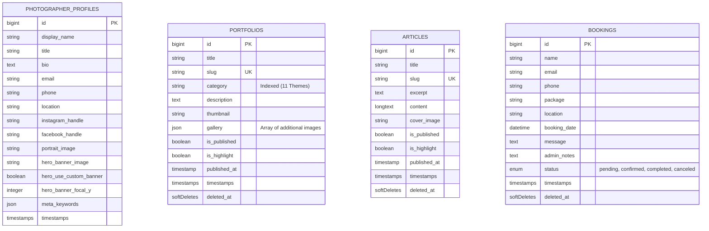
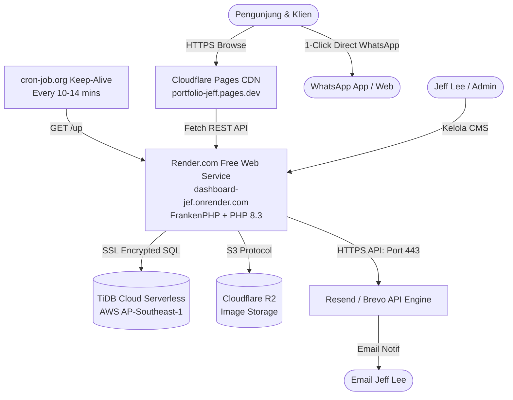

# Product Requirements Document (PRD)
## Jeff Lee — Photography Portfolio & Booking Platform

* **Document Version:** 2.0.0
* **Last Updated:** 2026-11-18
* **Authors:** Antigravity Engineering & yodi-dev
* **Status:** Production-Ready (Zero-Budget Architecture Deployed)

---

## 1. Project Overview & Vision

### 1.1 Objective
Membangun platform website portofolio profesional dan sistem manajemen reservasi (*booking system*) terintegrasi untuk fotografer **Jeff Lee** yang beroperasi di Australia. Platform ini dirancang dengan estetika visual Jepang minimalis bernuansa editorial, kecepatan muat tinggi, storytelling emosional di balik karya pemotretan, serta kemudahan bagi calon klien untuk melakukan reservasi sesi foto langsung dari desktop maupun perangkat mobile.

### 1.2 Decoupled / Headless System Architecture
Sistem dipisahkan menjadi dua aplikasi mandiri untuk memaksimalkan performa, keamanan, pemeliharaan independen, dan biaya operasional Rp 0 (*Zero-Cost Cloud*):

* **Frontend (Client-Facing Web):** [portfolio-jeff](https://github.com/yodi-dev/portfolio-jeff)
  * Framework: **Nuxt 3 (v3.17)** + **Vue 3 (v3.5)** + **Tailwind CSS 3.4** + **TypeScript**.
  * Hosting & CDN: **Cloudflare Pages** (Global Edge CDN, auto-deployment via Git).
  * Karakter Visual: Minimalist Japanese Washi-paper tones (`#FAF9F6`), serif editorial typography (*Cormorant Garamond*), micro-interactions halus, dan dark mode switch.
* **Backend (Headless API & CMS):** [dashboard-jef](https://github.com/yodi-dev/dashboard-jef)
  * Framework: **Laravel 12** + **Laravel Breeze** + **Sanctum** + **FrankenPHP / Caddy**.
  * Database: **TiDB Cloud Serverless** (MySQL 8 protocol, auto-scaling, SSL encrypted `MYSQL_ATTR_SSL_CA`).
  * Hosting: **Render.com Free Web Service** (Dockerized FrankenPHP runtime).
  * Storage: **Cloudflare R2** / Local Symlink Storage (S3-compatible).
  * Availability: Auto Keep-Alive via `cron-job.org` HTTP pings to `/up`.

---

## 2. Functional Requirements & Site Structure

### 2.1 Main Page (Homepage — `/`)
* **Dynamic 21:9 Hero Banner:**
  * Mode A (Portfolio Highlight): Mengambil otomatis karya portofolio terbaru yang ditandai *Highlight*.
  * Mode B (Custom Banner): Mengambil foto banner kustom 21:9 beresolusi tinggi dengan kontrol posisi *Rule-of-Thirds* (`hero_banner_focal_y` 0% - 100%) yang diatur dari admin.
  * Navigasi Hero cerdas: Menghubungkan pengunjung ke `/works` (bila custom banner) atau langsung ke detail karya `/works/[slug]` (bila highlight).
* **Photographer Branding & Headline:** Nama fotografer ("JEF LEE Photography") dan filosofi fotografi (*natural light, quiet storytelling, human authenticity*).
* **Selected Works Curated Grid:** Menampilkan kartu-kartu foto unggulan terkurasi langsung dari database.
* **Reflections & Stories Snippet:** Cuplikan artikel cerita terbaru dari menu Writing.
* **About Snippet & Testimonials:** Pengantar singkat sosok Jeff Lee dan kutipan apresiasi klien.
* **Call to Action (CTA):** Tombol pemesanan sesi yang mengarahkan ke halaman `/booking`.

### 2.2 Works / Portfolio Hub & Detail Page
* **Index Page (`/works`):**
  * **11 Kategori Fotografi Resmi:**
    1. *Family*
    2. *Portrait*
    3. *Couple*
    4. *Newborn*
    5. *Work Documentary*
    6. *Animal*
    7. *Plant*
    8. *Sports*
    9. *Event*
    10. *Celebration*
    11. *Travel*
  * **Interactive Filter:** Tab navigasi instan tanpa reload halaman dengan status counter karya aktif.
  * **Multiples of 3 Exhibition Grid:** Tampilan grid yang otomatis menyesuaikan kelipatan 3 agar tata letak galeri selalu simetris dan rapi.
* **Dedicated Detail Page (`/works/[slug]`):**
  * Halaman pameran mandiri untuk setiap album/sesi pemotretan.
  * Menampilkan cerita mendalam, metadata pemotretan (kategori, tanggal, lokasi).
  * **Multi-Image Exhibition Grid:** Menampilkan foto sampul dan seluruh foto seri tambahan (*gallery*).
  * **Interactive Lightbox Modal:** Pembesar foto resolusi penuh dengan navigasi keyboard (`Esc`, `ArrowLeft`, `ArrowRight`).
  * **SEO & Social Sharing:** Schema.org `VisualArtwork` structured data dan OpenGraph image cards.

### 2.3 Writing / Stories Page (`/writing` & `/writing/[slug]`)
* **Index Page (`/writing`):** Daftar esai visual dan refleksi di balik lensa dengan cover foto, judul, dan ringkasan (*excerpt*).
* **Detail Page (`/writing/[slug]`):** Halaman artikel lengkap dengan tipografi editorial yang nyaman dibaca, tanggal rilis, dan sanitasi konten HTML aman.

### 2.4 About Page (`/about`)
* Narasi mendalam mengenai perjalanan fotografi Jeff Lee di Australia, etos kerja pencahayaan alami, dan foto profil portrait resmi.
* Informasi domisili, email resmi, dan media sosial aktif.

### 2.5 Contact Page (`/contact`)
* Halaman kontak langsung yang menyediakan email, nomor WhatsApp internasional, dan lokasi kerja, yang tersinkronisasi dinamis dari data `GET /api/profile`.

### 2.6 Booking Page (`/booking`) & Dual-Channel Notifications
* **Formulir Reservasi Interaktif:**
  * Input Nama Lengkap, Alamat Email Aktif, Nomor Telepon/WhatsApp Internasional.
  * Dropdown Paket Sesi yang selaras dengan 11 tema fotografi.
  * Pemilihan Tanggal Sesi (minimal tanggal besok).
  * Lokasi Sesi Pemotretan dan Catatan Khusus/Konsep.
* **State & Handling:**
  * Validasi klien real-time dan timeout API 15 detik untuk mengakomodasi cold-start backend gratis.
  * Umpan balik transparan: Pesan error informatif jika ada kendala jaringan, tanpa status sukses palsu (*anti-silent failure*).
* **Dual-Channel Notification Workflow:**
  1. **HTTPS Email Notification:** Backend mengirim notifikasi ke email admin menggunakan Resend API / Brevo API melalui port HTTPS 443 (kebal terhadap blokir port SMTP 25/465/587 pada hosting gratis Render).
  2. **1-Click WhatsApp Direct Action:** Pada layar sukses formulir ("Thank You"), klien disajikan tombol hijau instan untuk langsung menyapa Jeff di WhatsApp dengan teks ringkasan booking yang sudah terformat otomatis.

### 2.7 Editorial Error Recovery (`error.vue`)
* Halaman error terpadu untuk 404 (Out of Frame) dan 500 (Exposure Paused).
* Menggunakan estetika minimalis, framing marks kamera 35mm, serta tombol pemulihan satu-klik menuju `/works` dan `/`.

---

## 3. Data Contracts & API Specifications

| Method | Endpoint | Query / Body | Deskripsi | Status |
| :--- | :--- | :--- | :--- | :--- |
| `GET` | `/up` | - | Health check endpoint untuk monitor uptime & keep-alive cron | `200 OK` |
| `GET` | `/api/profile` | - | Mengambil data profil fotografer, hero banner, framing focal point, kontak, & SEO | `200 OK` |
| `GET` | `/api/portfolios` | `?category=...` | Mengambil daftar portofolio terpublikasi | `200 OK` |
| `GET` | `/api/portfolios/{slug}` | - | Mengambil detail portofolio & array galeri foto lengkap | `200 OK` / `404` |
| `GET` | `/api/articles` | - | Mengambil daftar artikel terpublikasi | `200 OK` |
| `GET` | `/api/articles/{slug}` | - | Mengambil artikel lengkap berdasarkan slug | `200 OK` / `404` |
| `POST` | `/api/bookings` | JSON Body | Mengirim formulir reservasi klien & memicu notifikasi | `201 Created` |

### Sample Payload: POST `/api/bookings`
```json
{
  "name": "Sarah Jenkins",
  "email": "sarah.j@example.com",
  "phone": "+61412345678",
  "package": "Family",
  "location": "Centennial Park, Sydney",
  "booking_date": "2026-12-05",
  "message": "We would love an outdoor afternoon golden hour session with our 2-year old daughter."
}
```

---

## 4. Database Architecture (TiDB Cloud Serverless)



---

## 5. Zero-Budget Deployment Topology



---

## 6. Implementation & Operational Status

* [x] **Fase 1: Modern Frontend Core (Nuxt 3 + Tailwind CSS)** — Beranda, About, Works, Writing, Booking, Contact, Dark Mode, SSR/SSG.
* [x] **Fase 2: Headless CMS & 11 Photography Themes** — Laravel 12 API, migrasi kategori, CRUD, multi-image upload, soft-delete trash.
* [x] **Fase 3: Cloud Database & Storage** — Migrasi ke TiDB Cloud Serverless dengan SSL, integrasi Cloudflare R2 driver.
* [x] **Fase 4: Public Profile & 21:9 Hero Studio** — Manajemen profil dinamis, Rule-of-Thirds interactive preview, vertical focal point slider (0-100%).
* [x] **Fase 5: Robust Notification Engine** — Outbound HTTPS API (Resend & Brevo), timeout 5s anti-hang, 1-Click WhatsApp direct chat.
* [x] **Fase 6: Dedicated Album Exhibits & Multiples of 3 Grid** — Halaman `/works/[slug]`, Lightbox keyboard navigation, dynamic exhibition balancing.
* [x] **Fase 7: Editorial Error Recovery & Uptime Maintenance** — Custom `error.vue` 404/500, cron-job.org keep-alive pinging, comprehensive automated test suite (60 tests passed, 224 assertions).
* [x] **Fase 8: Handover & Documentation** — Panduan operasional klien (`HANDOVER_MANUAL.md`), update PRD v2.0, update README kedua repositori.
